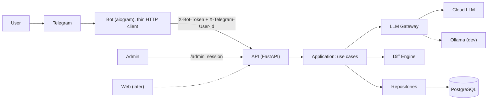

# Engleks: MVP Architecture

## 1. Goal and MVP scope

A trainer for English writing, not a translator. The MVP includes:

- **Improve**: modes `minimal` (default), `natural` and `polished`. Returns a list of changes, each with a category and an explanation.
- **Translate**: UA/RU → EN with automatic language detection, in the same LLM call as Improve.
- **Context profiles**: 2–3 per user, plus request history.
- **Multiple users**: invite codes, usage limits and a simple admin dashboard.

Out of scope for the MVP: SRS/FSRS, saved vocabulary, Explain, How to say, voice, exercises and the web client. The API is ready for a web client later.

## 2. Components



**Bot**: receives messages, calls the API and renders the reply. Long replies are split into 4096-character messages, with inline buttons. The bot has no database and no business logic.

**API**: the single entry point. Layers: Transport (routes, auth, validation) → Application → Domain.

**Application (use cases)**:

- User: `ProcessText` (Improve/Translate), `ManageProfiles`, `GetHistory`, `RedeemInvite`.
- Admin: `ListUsers`, `SetUserStatus`, `SetUserLimits`, `CreateInvite`, `RevokeInvite`, `UsageStats`.

**LLM Gateway**:

- `LLMProvider` port with adapters: LiteLLM or a cloud provider, and Ollama for development.
- Versioned prompt templates.
- Structured output validated with Pydantic, with one retry on invalid JSON.

**Diff Engine**: computes a word-level diff in code with `difflib` and matches it to the model's changes.

**Persistence**: PostgreSQL with SQLAlchemy and Alembic. Raw LLM responses are stored as JSONB.

**Admin UI**: server-rendered pages (Jinja2 + htmx, or SQLAdmin) mounted at `/admin` inside the API.

## 3. Main flow

```mermaid
sequenceDiagram
  participant B as Bot
  participant A as API
  participant L as LLM Gateway
  participant D as PostgreSQL
  B->>A: POST /v1/texts/process {text, mode, profile_id}
  A->>D: auth: identity → user, status, limits
  A->>D: rate limit + daily budget check
  A->>A: detect language, build prompt
  A->>L: generate(schema)
  L-->>A: JSON {variants, changes[], vocabulary_candidates}
  A->>A: compute diff
  A->>D: save interaction, corrections; usage_daily += tokens
  A-->>B: ProcessResult DTO
```

Errors:

- `401`: unknown user, invite required.
- `403`: user disabled.
- `429`: `rate_limit` or `daily_budget`.
- `502`: LLM failure.

## 4. Authentication (option A)

- The bot and the API share a secret, `X-Bot-Token`. The bot also sends `X-Telegram-User-Id`.
- Signup: `/start <code>` or a deep link → `POST /v1/auth/redeem {telegram_id, code}` → a user and an identity are created.
- Auth is isolated in an `AuthContext → user_id` layer, so use cases don't know about Telegram.
- Possible later options: B (per-user JWT) and C (web login with Telegram Login or OIDC, plus account linking).

## 5. Limits

- Rate limit: N requests per minute per user. Counters in Postgres for the MVP, Redis later.
- Daily token budget: checked before the LLM call and updated after it.
- Defaults are set in config. `user.limits_override` changes them for one user.

## 6. Admin dashboard

- **Login**: admin credentials from env, with a session cookie.
- **Users**: status, last activity, requests and tokens for today and the last 7 days. Actions: enable or disable a user, set limits.
- **Invite codes**: create, revoke, see who redeemed them.
- **Overview**: active users, requests and LLM cost per day.

## 7. Data

| Table | Purpose |
| --- | --- |
| `user` | status (active/disabled), `limits_override`, settings (explanation language, default mode) |
| `identity` | provider (telegram, later web), `external_id` → user |
| `invite_code` | code, `created_by`, `max_uses`, `used_count`, `expires_at`, revoked |
| `context_profile` | audience, tone, channel, glossary |
| `interaction` | input, mode, language, full JSON response, model, prompt version, tokens, cost |
| `correction` | original, replacement, category, explanation → interaction |
| `usage_daily` | `user_id`, date, requests, `tokens_in`, `tokens_out`, cost |

## 8. API (draft)

- `POST /v1/auth/redeem`
- `POST /v1/texts/process`
- `GET/POST/PATCH /v1/profiles`
- `GET /v1/history`
- `GET/PATCH /v1/me/settings`
- `/admin/*`: server-rendered pages

## 9. Deployment

Docker Compose with three services: `api`, `bot` (long polling for the MVP) and `postgres`. Configuration comes from env, with secrets kept separately. Token usage and cost are logged.
