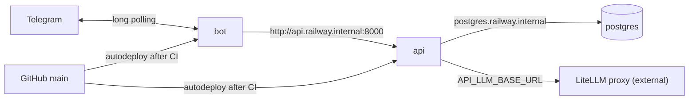

# Production on Railway

How engleks runs in production and how to operate it. The environment is described in
[`.railway/railway.ts`](../../.railway/railway.ts); the reasoning behind it is in the
[design spec](../superpowers/specs/2026-11-12-railway-deployment-design.md).

## What runs where



One Railway project, `engleks`, environment `production`, region `europe-west4`
(`europe-west4-drams3a`). It holds three resources:

| Resource | What it is |
| --- | --- |
| `postgres` | Railway-managed Postgres 18 with a volume. No TCP proxy: it is reachable only from inside the project |
| `api` | `apps/api/Dockerfile`. Migrations run as its pre-deploy command; Railway checks `GET /readyz` before switching traffic. No public domain |
| `bot` | `apps/bot/Dockerfile`. Long polling, exactly one replica |

Traffic between them stays on Railway's private network. The LiteLLM proxy runs outside
Railway; the api reaches it through `API_LLM_BASE_URL`.

### Cost

Estimated from Railway's published rates at MVP traffic:

| Service | RAM | ≈ per month |
| --- | --- | --- |
| api | 120–200 MB | $1.40–2.60 |
| bot | 70–120 MB | $0.90–1.40 |
| postgres + 1 GB volume | 100–250 MB | $1.40–3.20 |
| **usage total** | | **≈ $4–7** |

On the Hobby plan ($5 including $5 of usage) that is about $5–7 a month; Pro ($20 including
$20) covers it flat. LLM tokens and LiteLLM hosting are extra. Railway's usage page is the real
number once the services have run for a few days.

## Bootstrap (one time)

1. Create the Railway project `engleks` (its default environment is `production`). Install the
   Railway GitHub App on `topol-3000/engleks`, and connect the GitHub account of a project
   member who has access to the repo. "Wait for CI" needs that connection.
2. Create a project token scoped to `production` and store it as the repo secret
   `RAILWAY_TOKEN` (GitHub → Settings → Secrets and variables → Actions).
3. Make sure nothing else polls the production Telegram token, for example a local `make up`.
   Local development uses a separate test bot.
4. Open one PR with the Dockerfiles, `.railway/`, the workflows and the docs. The Dockerfile
   change must land no later than the IaC, or the first Railway build fails. The plan workflow
   runs on the PR that adds it.
5. Merge. The apply creates `postgres`, `api` and `bot`. Their first deploy is expected to
   fail: the secrets are still empty, so `Settings` validation fails in the pre-deploy step.
6. Set the values in [Secrets and Railway-held values](#secrets-and-railway-held-values), then
   redeploy `api` and `bot`.
7. Create the first invite (see [Admin CLI in production](#admin-cli-in-production)).

## Secrets and Railway-held values

These variables are declared as `preserve()` in `railway.ts`: IaC never sets or changes them,
and their values exist only in Railway. Never put them in git, CI or a commit message.

| Variable | Service | Where the value comes from | Seal? |
| --- | --- | --- | --- |
| `API_SERVICE_TOKEN` | api | `openssl rand -hex 32` | **No**: the bot's `BOT_SERVICE_TOKEN` references it, and a sealed variable cannot be referenced |
| `API_LLM_API_KEY` | api | the LiteLLM virtual key for the api | Yes |
| `API_LLM_BASE_URL` | api | the LiteLLM proxy's URL | No |
| `API_BOT_USERNAME` | api | the production bot's username, without `@` (BotFather). Not a secret; optional, without it `engleks-admin` prints no t.me link | No |
| `BOT_TELEGRAM_TOKEN` | bot | BotFather | Yes |

To set them: Railway → project `engleks` → service → **Variables**, enter the value, then for
the two sealed ones open the variable's menu and choose **Seal**. Then redeploy the service
(Railway shows a "deploy" prompt for staged variable changes).

`BOT_SERVICE_TOKEN` is not set by hand: it is a reference to `api`'s `API_SERVICE_TOKEN`, so
the two can never differ.

### Rotation

Change the value in the Railway UI, then redeploy. For `API_SERVICE_TOKEN`, redeploy **both
`api` and `bot`**: the bot reads the token through the reference only when it starts.

## How a deploy happens

### Application code

A push to `main` (normally a merged PR):

1. Every GitHub Actions workflow on the commit finishes ("Wait for CI"). If one fails, Railway
   skips the deployment. This includes `Railway apply` when the commit touches `.railway/`.
2. Railway builds the image of each service whose watch patterns match the changed files.
   A commit that touches only docs or `.railway/` deploys nothing; a bot-only commit
   redeploys only the bot. Both images are rebuilt by changes to `pyproject.toml`, `uv.lock`
   or `packages/contracts/`.
3. api: `alembic upgrade head` runs in the new image against Postgres. If it fails, the deploy
   stops and the old api keeps serving.
4. api: the new container must answer `GET /readyz` with 2xx (the database probe) within
   120 s; then traffic switches. Otherwise the old api keeps serving.
5. bot: the new container starts and the old one stops. Telegram may answer one `getUpdates`
   with 409 while both poll, and aiogram retries it.

The api and the bot deploy independently. That is safe because migrations are expand-only
(see AGENTS.md): the previous release's code keeps working against a migrated schema.

### Infrastructure (`.railway/`)

1. Open a PR that changes `.railway/railway.ts`. The `Railway plan` workflow comments the plan
   on the PR: what is created, changed or deleted. Secret values show as `«hidden»`.
2. Review the plan like code. Watch for deletions: deleting `postgres` deletes the data.
3. Merge. `Railway apply` applies exactly the plan pinned on the PR.

The apply fails, by design, when:

- the commit reached `main` without a PR (a direct push has no pinned plan), or
- the environment changed since the plan (someone edited it in the UI, or another apply ran).

In both cases, open a new PR (an empty change to `.railway/` is enough) to get a fresh plan,
and merge it.

The CLI the workflows use is pinned (`cli-version: "5.71.0"`). Raise it in its own PR once a
newer release has been out a week or two.

## Rollback

Railway → service → **Deployments** → pick the previous successful deployment → **Redeploy**.
No down-migration runs, and none is needed: migrations are expand-only, so the older code works
against the newer schema. Then revert the bad change on `main`, or the next push deploys it
again.

## Logs

Railway → service → **Logs** (the `api` and `bot` logs are JSON, one event per line), or from a
terminal with the [Railway CLI](https://docs.railway.com/guides/cli) linked to the project:

```bash
railway logs --service api
railway logs --service bot
```

Build and pre-deploy (migration) output is on the deployment's **Build Logs** and **Deploy
Logs** tabs.

## Admin CLI in production

`engleks-admin` is in the api image. Open a shell in the running api container and run it there:

```bash
railway ssh --service api
engleks-admin invite create
engleks-admin --help   # every other admin command
```

## Known gaps

- **No Postgres backups yet.** This is the largest gap: set up Railway volume backups or a
  `pg_dump` cron before real users depend on the data.
- No public domain, so the `/admin` dashboard is not reachable from outside. Add one when the
  dashboard exists.
- Secrets are entered by hand in Railway; Infisical as their source is a follow-up.
- No staging or PR environments.
- No alerting or uptime monitoring.
- `/readyz` probes only the database: a broken LiteLLM proxy does not fail a deploy. Check a
  real message in Telegram after changes to the LLM settings.
