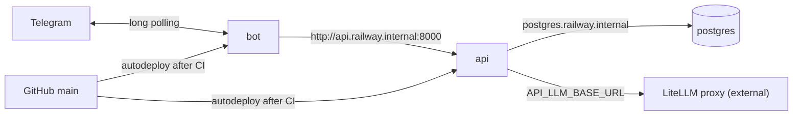

# Railway Deployment: Design

Status: draft for review · Date: 2026-11-12 · Related: [MVP Architecture](../../architecture.md),
[Project Structure](2026-11-01-project-structure-design.md)

## 1. Goal

Run the API and the bot in production on [Railway](https://railway.com), with a Railway-managed
Postgres. A merge to `main` deploys a migrated, healthy API and a running bot without manual
steps. The whole Railway environment is described in the repo as Infrastructure as Code (IaC).

The deployment that was removed in `387ea41` (server scripts, Deploy workflow, GHCR) is not
coming back. `compose.prod.yaml` stays as a platform-neutral fallback.

## 2. Decisions

| Area | Decision |
| --- | --- |
| Runs on Railway | `api`, `bot`, `postgres` (managed Postgres 18) |
| Runs elsewhere | the LiteLLM proxy; the API reaches it via `API_LLM_BASE_URL` |
| Environments | one: `production`, region `europe-west4` |
| Code deploys | Railway's GitHub integration on `main`, with "Wait for CI" (`checkSuites: true`); Railway builds our Dockerfiles |
| Infra definition | Railway IaC in TypeScript: `.railway/railway.ts` (Config as Code, `railway.toml`/`railway.json`, is deprecated and stops being read on 2026-12-01) |
| Applying IaC | the `railwayapp/config` GitHub Action: plan comment on PRs that touch `.railway/**`, apply on merge |
| Where IaC lives | this repo: an infra change and the code that needs it land in one PR. Revisit if several products share the Railway project or infra gets a separate owner |
| Secrets | set once in Railway's UI, declared in IaC as `preserve()`; never in git or CI logs. Infisical is out of scope for now |
| Migrations | Railway pre-deploy command `alembic upgrade head` on the api service; no `migrate` service |
| Dockerfiles | stay single-stage; drop the uv cache mount (Railway rejects cache mounts without a service-id `id`); install dependencies in their own layer before copying the source |

### Estimated cost

From Railway's published rates ($10/GB-month RAM, $20/vCPU-month CPU, $0.15/GB-month volume,
$0.05/GB egress) and typical footprints at MVP traffic:

| Service | RAM | ≈ per month |
| --- | --- | --- |
| api | 120–200 MB | $1.40–2.60 |
| bot | 70–120 MB | $0.90–1.40 |
| postgres + 1 GB volume | 100–250 MB | $1.40–3.20 |
| **usage total** | | **≈ $4–7** |

On the Hobby plan ($5 including $5 of usage) that is about $5–7 a month; Pro ($20 including $20)
covers it flat. LLM tokens and LiteLLM hosting are not included. Railway's usage page replaces
these estimates after the first days.

## 3. Topology



All three run in one Railway project, `engleks`, environment `production`. Traffic between them
stays on Railway's private network (dual-stack for environments created after 2025-10-16, so
uvicorn's `--host 0.0.0.0` works). Nothing is exposed publicly: the API has no public domain until
the admin dashboard needs one, and Postgres has no TCP proxy.

### Services

| | `api` | `bot` |
| --- | --- | --- |
| Source | `github("topol-3000/engleks", { branch: "main", checkSuites: true })` | same |
| Build | `builder: "DOCKERFILE"`, `dockerfilePath: "apps/api/Dockerfile"` | `dockerfilePath: "apps/bot/Dockerfile"` |
| Watch patterns | `apps/api/**`, `packages/contracts/**`, `pyproject.toml`, `uv.lock`, `apps/bot/pyproject.toml` | `apps/bot/**`, `packages/contracts/**`, `pyproject.toml`, `uv.lock`, `apps/api/pyproject.toml` |
| Pre-deploy | `alembic upgrade head` | none |
| Healthcheck | `/readyz`, timeout 120 s | none (no HTTP server) |
| Restart policy | `ON_FAILURE` | `ALWAYS` |
| Replicas | 1 | 1 (two pollers on one token conflict) |
| Overlap | default | `overlapSeconds: 0` |

Each image copies the other app's `pyproject.toml` for the uv workspace, so each watches it too.
A commit that touches only docs or `.railway/` deploys nothing; a bot-only commit redeploys only
the bot.

### Rollout of a push to `main`

1. Every GitHub Actions workflow on the commit finishes ("Wait for CI"). If one fails, Railway
   skips the deployment. This includes `railway-apply` when the commit touches `.railway/`.
2. Railway builds the image of each service whose watch patterns match.
3. api: `alembic upgrade head` runs in the new image against Postgres. If it fails, the deploy
   stops and the old api keeps serving.
4. api: the new container must answer `GET /readyz` with 2xx (the database probe) within the
   timeout; then traffic switches. Otherwise the old api keeps serving.
5. bot: the new container starts and the old one stops. Telegram may answer one `getUpdates`
   with 409 while both poll, and aiogram retries it.

The api and the bot deploy independently. That is safe because migrations are expand-only
(AGENTS.md): the previous release's code keeps working against a migrated schema.

## 4. Variables and secrets

Rule: non-secret values are literals in `railway.ts` and reviewed in PRs; secrets are `preserve()`
(the value lives only in Railway); anything derivable is a reference.

### `api`

| Variable | Value in `railway.ts` |
| --- | --- |
| `API_DB_CONNECTION_STRING` | `"postgresql+asyncpg://${{postgres.PGUSER}}:${{postgres.PGPASSWORD}}@${{postgres.PGHOST}}:${{postgres.PGPORT}}/${{postgres.PGDATABASE}}"`: a literal Railway template, resolved at deploy time. Railway's generated password is alphanumeric, so no percent-encoding is needed |
| `API_SERVICE_TOKEN` | `preserve()`; generated once with `openssl rand -hex 32` |
| `API_LLM_API_KEY` | `preserve()`; the LiteLLM virtual key |
| `API_LLM_BASE_URL` | `preserve()` until the proxy's URL is fixed, then a literal |
| `API_LLM_MODEL` | `"engleks-rewrite"` |
| `API_RATE_LIMIT_PER_MINUTE` | `"10"` |
| `API_DAILY_TOKEN_BUDGET` | `"200000"` |
| `API_BOT_USERNAME` | the production bot's username |
| `API_LOG_FORMAT`, `API_LOG_LEVEL` | `"json"`, `"INFO"` |
| `PORT` | `"8000"`: Railway's healthcheck calls `PORT`, and uvicorn listens on 8000 |

### `bot`

| Variable | Value in `railway.ts` |
| --- | --- |
| `BOT_TELEGRAM_TOKEN` | `preserve()` |
| `BOT_SERVICE_TOKEN` | `api.env.API_SERVICE_TOKEN`: a reference, so the two tokens can never differ |
| `BOT_API_BASE_URL` | `"http://${{api.RAILWAY_PRIVATE_DOMAIN}}:8000"` |
| `BOT_LOG_FORMAT`, `BOT_LOG_LEVEL` | `"json"`, `"INFO"` |

`BOT_TELEGRAM_TOKEN` and `API_LLM_API_KEY` are sealed in Railway's UI after they are set.
`API_SERVICE_TOKEN` stays unsealed so the bot can reference it.

The SDK's references are objects, not strings, so `` `${db.env.PGUSER}` `` does not interpolate.
Variables built from several values use Railway's own `${{service.VAR}}` syntax in a plain string.

No application code changes: `Settings` still reads environment variables, and `/run/secrets`
does not exist on Railway, which `config.py` already handles.

### Sketch of `.railway/railway.ts`

Illustrative; exact helper usage is settled in the implementation against `railway@3.16.0`.

```ts
import { defineRailway, github, postgres, preserve, service } from "railway/iac";

const source = github("topol-3000/engleks", { branch: "main", checkSuites: true });
const shared = ["pyproject.toml", "uv.lock", "packages/contracts/**"];

export default defineRailway((ctx, project) => {
  const db = postgres("postgres");

  const api = service("api", {
    source,
    build: {
      builder: "DOCKERFILE",
      dockerfilePath: "apps/api/Dockerfile",
      watchPatterns: ["apps/api/**", "apps/bot/pyproject.toml", ...shared],
    },
    preDeploy: "alembic upgrade head",
    healthcheck: "/readyz",
    healthcheckTimeout: 120,
    deploy: { restartPolicyType: "ON_FAILURE" },
    env: {
      API_DB_CONNECTION_STRING:
        "postgresql+asyncpg://${{postgres.PGUSER}}:${{postgres.PGPASSWORD}}" +
        "@${{postgres.PGHOST}}:${{postgres.PGPORT}}/${{postgres.PGDATABASE}}",
      API_SERVICE_TOKEN: preserve(),
      API_LLM_API_KEY: preserve(),
      API_LLM_BASE_URL: preserve(),
      API_LLM_MODEL: "engleks-rewrite",
      // ... remaining literals from the table above
      PORT: "8000",
    },
  });

  const bot = service("bot", {
    source,
    build: {
      builder: "DOCKERFILE",
      dockerfilePath: "apps/bot/Dockerfile",
      watchPatterns: ["apps/bot/**", "apps/api/pyproject.toml", ...shared],
    },
    deploy: { restartPolicyType: "ALWAYS", overlapSeconds: 0 },
    env: {
      BOT_TELEGRAM_TOKEN: preserve(),
      BOT_SERVICE_TOKEN: api.env.API_SERVICE_TOKEN,
      BOT_API_BASE_URL: "http://${{api.RAILWAY_PRIVATE_DOMAIN}}:8000",
      BOT_LOG_FORMAT: "json",
      BOT_LOG_LEVEL: "INFO",
    },
  });

  return project("engleks", { resources: [db, api, bot] });
});
```

## 5. Repo changes

### New: `.railway/`

- `railway.ts`: the environment from sections 3 and 4.
- `package.json` and `package-lock.json`: `railway` pinned to an exact version (`3.16.0`), the
  only dependency. Node 22+ is needed only by whoever runs the Railway CLI; locally that runs in
  Docker.
- `.gitignore` gains `node_modules/`. CI's Trivy filesystem scan picks up the lockfile.

### New workflows

Railway's documented split layout, so the apply run shows on the merge commit:

- `.github/workflows/railway-plan.yml`: `on: pull_request` with `paths: [".railway/**"]`; runs
  `railwayapp/config` with `command: plan` and posts the plan as a PR comment. Skipped for PRs
  from forks. Permissions: `contents: read`, `pull-requests: write`.
- `.github/workflows/railway-apply.yml`: `on: push` to `main` with `paths: [".railway/**"]`;
  `command: apply` applies the plan pinned to the merged PR. Permissions: `contents: read`,
  `actions: read`, `pull-requests: read`. A direct push without a PR has no pinned plan and fails
  by design.

Both follow `ci.yml`: actions pinned by SHA (`railwayapp/config@9e17d413dbe219f19d62538d9c06b5dbb5e9abf8 # v1.2.0`,
`actions/checkout` at the SHA `ci.yml` uses), `persist-credentials: false`, and a pinned
`cli-version` instead of `latest`.

New repository secret: `RAILWAY_TOKEN`, a Railway project token scoped to `production`.

### Changed: Dockerfiles

In both `apps/api/Dockerfile` and `apps/bot/Dockerfile`:

- Remove `--mount=type=cache,target=/root/.cache/uv`. Railway accepts cache mounts only as
  `id=s/<service-id>-<path>`, which would tie the Dockerfiles to one Railway project.
- Split `uv sync` in two, so a code-only change reuses the dependency layer without any cache
  mount:

```dockerfile
COPY pyproject.toml uv.lock ./
COPY apps/api/pyproject.toml apps/api/
COPY apps/bot/pyproject.toml apps/bot/
COPY packages/contracts/pyproject.toml packages/contracts/
RUN --mount=from=ghcr.io/astral-sh/uv:0.13.6@sha256:...,source=/uv,target=/bin/uv \
    UV_COMPILE_BYTECODE=1 UV_LINK_MODE=copy UV_PYTHON_DOWNLOADS=0 \
    uv sync --frozen --no-dev --no-install-workspace --package engleks-api
COPY packages/contracts packages/contracts
COPY apps/api/src apps/api/src
RUN --mount=from=ghcr.io/astral-sh/uv:0.13.6@sha256:...,source=/uv,target=/bin/uv \
    UV_COMPILE_BYTECODE=1 UV_LINK_MODE=copy UV_PYTHON_DOWNLOADS=0 \
    uv sync --frozen --no-dev --no-editable --package engleks-api
```

The images stay single-stage: uv is mounted, not copied, so a separate build stage would leave
the same runtime contents.

### Changed: docs

- New runbook `docs/deployment/railway.md`: the bootstrap (section 6), setting and rotating
  secrets, how a deploy happens, rollback (redeploy a previous deployment in Railway), logs,
  running `engleks-admin` in production (`railway ssh --service api`), and the cost estimate.
- `AGENTS.md`: `.railway/` in Layout; the "a config value" row adds `.railway/railway.ts`;
  `.railway/` joins "Ask before"; a one-line link to the runbook.
- `docs/architecture.md` §9 Runtime: production runs on Railway; LiteLLM is external.

### Unchanged

Application code, `compose.yaml`, `compose.prod.yaml`, `ci.yml`.

## 6. Bootstrap (one time, manual)

1. Create the Railway project `engleks` (default environment `production`). Install the Railway
   GitHub App on `topol-3000/engleks`, and connect a project member's GitHub account with access
   to the repo ("Wait for CI" needs it).
2. Create a project token scoped to `production` and store it as the repo secret `RAILWAY_TOKEN`.
3. Make sure nothing else polls the production Telegram token, e.g. a local `make up`. Local
   development uses a separate test bot.
4. Open one PR with the Dockerfiles, `.railway/`, the workflows and the docs. The Dockerfile
   change must land no later than the IaC, or the first Railway build fails. The plan workflow
   runs on the PR that adds it.
5. Merge. The apply creates `postgres`, `api` and `bot`. Their first deploy is expected to fail:
   the `preserve()` secrets are empty, so `Settings` validation fails in the pre-deploy step.
6. Set `API_SERVICE_TOKEN`, `API_LLM_API_KEY`, `API_LLM_BASE_URL` and `BOT_TELEGRAM_TOKEN` in
   Railway's UI, seal the Telegram and LLM keys, then redeploy `api` and `bot`.
7. Create the first invite: `railway ssh --service api`, then `engleks-admin invite create`.

## 7. Verification

### Assumptions the first plan and deploy must confirm

| Assumption | Fallback if wrong |
| --- | --- |
| `preserve()` on a variable that does not exist yet plans cleanly | The first apply omits the secret keys; set them in the UI; add `preserve()` in a follow-up PR |
| Literal `${{postgres.*}}` and `${{api.RAILWAY_PRIVATE_DOMAIN}}` strings pass through IaC and resolve at deploy | Use `ref()` for whole values, and let `config.py` accept `postgresql://` and add the driver (an app change, raised with the owner first) |
| Railway's builder supports `--mount=from=<image>` | `COPY --from=ghcr.io/astral-sh/uv:... /uv /bin/uv` in a throwaway stage |
| A healthcheck works on a service without a public domain | Add a Railway-generated domain to `api` |
| A service variable can reference another service's variable (`api.env.API_SERVICE_TOKEN`) | Set `BOT_SERVICE_TOKEN` as its own `preserve()` with the same value |

### Acceptance checklist

Run once after the bootstrap; record the results in the PR.

- [ ] The plan comment shows three resources created, with secret values `«hidden»`.
- [ ] The api deploy log shows `alembic upgrade head`, then a passing `/readyz` (the database).
- [ ] The bot log shows polling started. In Telegram, `/start <invite>` registers, and a text
      message gets a corrected reply. This is the only check that covers the LiteLLM path,
      because `/readyz` probes only the database.
- [ ] Wait for CI: a push to `main` stays WAITING until CI is green.
- [ ] Watch patterns: a docs-only commit deploys nothing; a bot-only commit redeploys only `bot`.
- [ ] Failure safety: a deploy whose pre-deploy or `/readyz` fails leaves the old api serving.
- [ ] Rollback: redeploying the previous deployment works.

### Automated tests

- The Dockerfile change is covered by CI's `images` job (build, smoke import, Trivy). Locally,
  after a source-only change, the dependency `uv sync` layer must be `CACHED`.
- `.railway/railway.ts` is evaluated and diffed by the plan job on every PR that touches it. No
  separate TypeScript type check: it would add a dependency for little extra coverage.
- `make lint && make test` are unaffected; no Python code changes.

## 8. Out of scope (follow-ups)

- **Postgres backups** (Railway volume backup schedules, or a `pg_dump` cron). This is the
  largest gap and should be the next deployment task.
- A public domain for `/admin`, when the dashboard exists.
- Infisical as the source of secrets (sync into Railway shared variables, `ctx.shared.X` in IaC).
- Staging and PR environments.
- Alerting and uptime monitoring.
- A readiness probe for LiteLLM.
